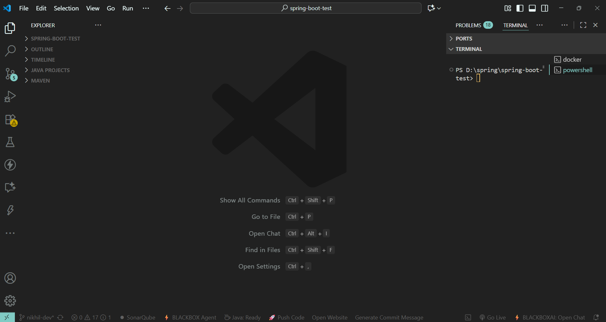

# swft-git-push 🚀  
*A VS Code extension to quickly add → commit → push your Git changes directly from VS Code with a single button or keyboard shortcut ⚡.

No need to open terminal every time!*

## Features ✨

🚀 One-click Git Push button in status bar.

📝 Prompt for commit message.

🌲 Auto-detect current branch and push to it.

📂 Supports multiple repos in workspace (asks which one).

⚡ Auto-installs swft CLI in the background.

⌨️ Keyboard shortcut support (e.g., Ctrl+Q).

🛡️ Handles empty commits (shows message if no changes).

---

### 📸 Demo



---

### 🚀 Usage 

1. Open a folder with a Git repository.

2. Click on 🚀 Push Code button in the status bar (bottom-left).
   OR press Ctrl+Q.

3. Enter commit message.

4. Changes will be:
```bash
git add .

git commit -m "your message"

git push origin <current-branch>
```
